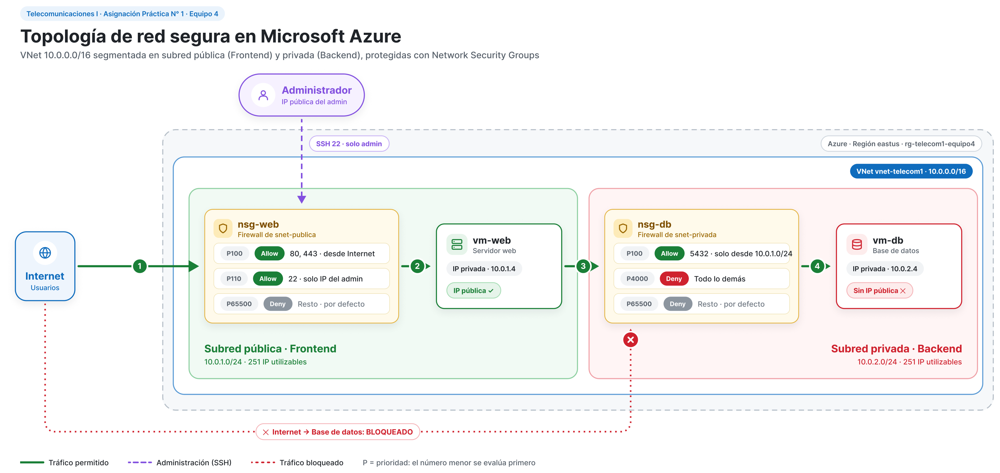

# Telecom I · Asignación Práctica N° 1 · Equipo 4

**Cloud Networking y Arquitectura Segura en Azure**
Telecomunicaciones I · Prof. Ing. Oscar Cedeño · UNEG · Ciudad Guayana

**Entrega:** viernes 20/11/2026, 12:00 PM, como `Telecom1_Asignacion1_Equipo4.zip` (informe técnico en PDF + script `despliegue_red_azure.sh`).

---

## De qué trata

Desplegar en Microsoft Azure una red corporativa segura, dividida en dos subredes y protegida con firewalls (NSG), y demostrar con pruebas que funciona:

- **Subred pública (Frontend)** `10.0.1.0/24`: servidor web `vm-web` (10.0.1.4) con IP pública.
- **Subred privada (Backend)** `10.0.2.0/24`: base de datos `vm-db` (10.0.2.4) **sin IP pública**.
- **VNet** `vnet-telecom1` `10.0.0.0/16`, región `eastus`.



Reglas de seguridad:

| NSG | Prioridad | Acción | Qué hace |
|---|---|---|---|
| `nsg-web` | 100 | Allow | HTTP/HTTPS (80, 443) desde Internet |
| `nsg-web` | 110 | Allow | SSH (22) solo desde la IP del administrador (/32) |
| `nsg-db` | 100 | Allow | PostgreSQL (5432) solo desde `10.0.1.0/24` |
| `nsg-db` | 4000 | Deny | Todo lo demás (cierra también el tráfico interno de la VNet) |

---

## Equipo y roles

| N° | Rol | Responsabilidad | Integrante |
|---|---|---|---|
| 1 | Arquitecto Cloud Lead | Direccionamiento CIDR, subredes, diagrama y pregunta 2.1 | Arnaldo Perdomo |
| 2 | Especialista en Redes | Subred pública/privada y enrutamiento (pregunta 2.2) | Anthony Medina |
| 3 | Ingeniero de Seguridad Cloud | Reglas de los NSG (pregunta 2.4) | Shirley Cedeño |
| 4 | DevOps y Automatización | Script de despliegue y pruebas | Angel Rodriguez |
| 5 | Auditor de Calidad e IA | Auditoría de la IA, validación e informe | Sebastián Ortiz 
---

## Cómo ejecutar el script

Necesitas una cuenta de Azure con crédito (por ejemplo, Azure for Students).

1. Entra a [portal.azure.com](https://portal.azure.com) y abre **Cloud Shell** (ícono `>_`) en modo **Bash**.
2. Sube `despliegue_red_azure.sh` con el botón *Cargar/Descargar archivos*.
3. Ejecuta:

```bash
chmod +x despliegue_red_azure.sh
./despliegue_red_azure.sh
```

Tarda entre 10 y 15 minutos. Al final debe decir **8 pruebas correctas, 0 con fallo**.

Variables opcionales:

```bash
ADMIN_IP=203.0.113.25 ./despliegue_red_azure.sh   # fijar la IP del admin para SSH
VM_SIZE=Standard_B2s  ./despliegue_red_azure.sh   # si no hay cupo de B1s
LOCATION=westus2      ./despliegue_red_azure.sh   # otra región
LIMPIAR=1             ./despliegue_red_azure.sh   # borra todo al terminar
```

Cuando tengas las capturas, elimina los recursos para no gastar crédito:

```bash
az group delete --name rg-telecom1-equipo4 --yes --no-wait
```

---
